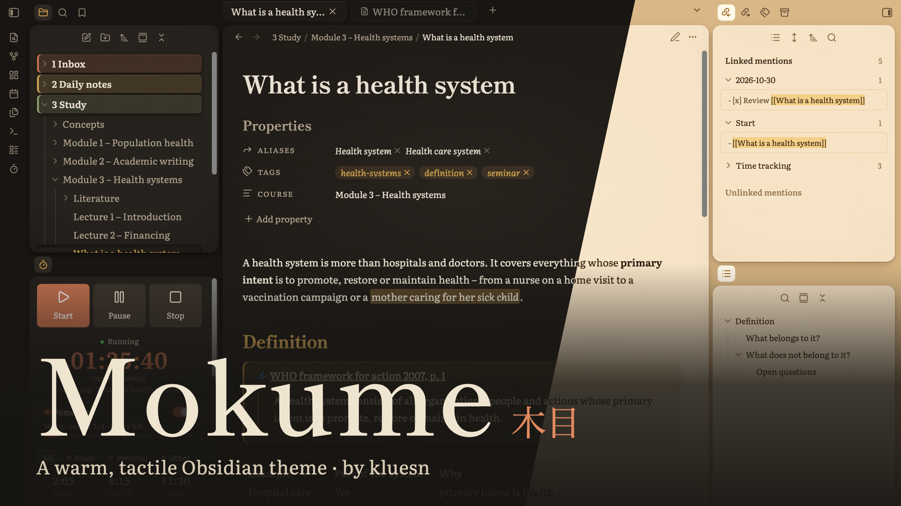
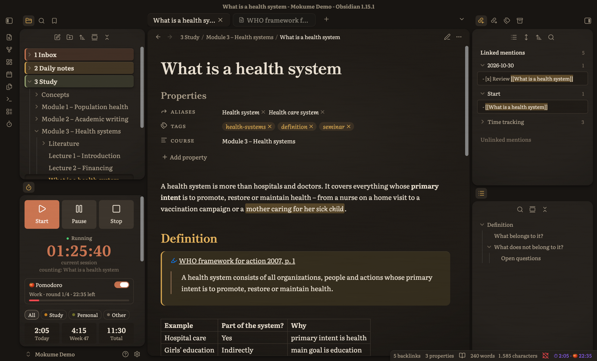
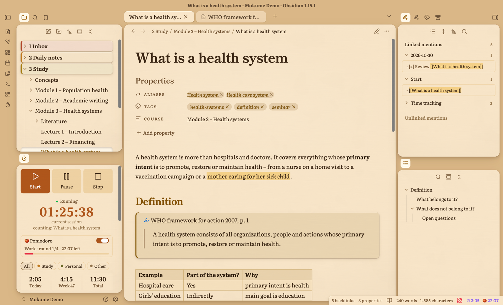
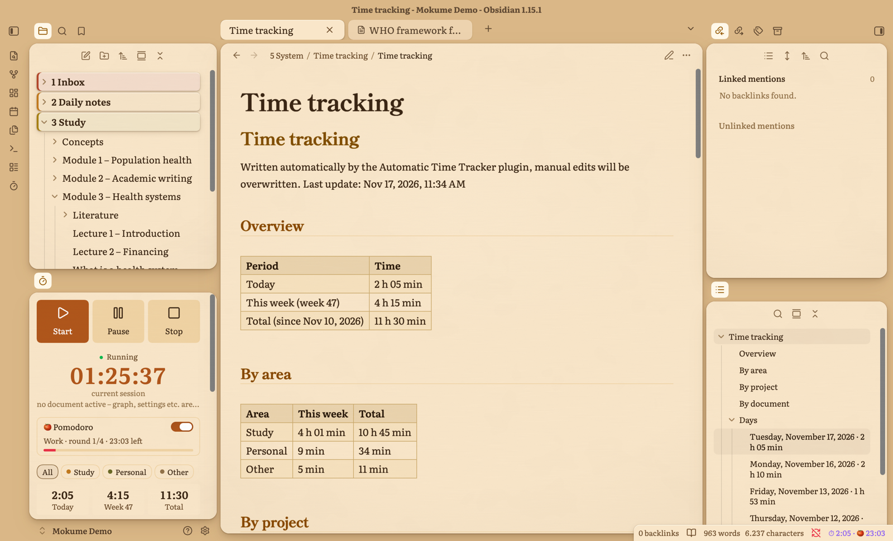

# Mokume

*木目 – Japanese for “wood grain”*

A warm, tactile theme for Obsidian, made for the long hours you spend in your notes. Instead of sterile white and cold greys, Mokume uses warm, earthy tones, soft shadows and paper with a fine, tactile grain. No harsh contrast and no hard divider lines: sidebar, editor and tabs rest like cards on a quiet desk, so the screen feels calm and easy on the eyes.

| Dark mode | Light mode |
| --- | --- |
|  |  |

## Works well with Automatic Time Tracker

The live sidebar in the screenshots is [Automatic Time Tracker](https://community.obsidian.md/plugins/automatic-time-tracker), a plugin by the same author: it tracks how long you work on each note, PDF and drawing.

## Features

- **Dark and light mode** – a cosy, espresso-toned dark mode and a bright, golden light mode inspired by evening sun on water
- **Warm heading gradient** – headings run from gold through amber and copper to coral and rose, all at the same brightness, so every level stands out
- **Japanese-inspired typography** – Shippori Mincho for headings, with the fine brush endings of Japanese book printing, and Literata, designed for long reading on screens, for text and interface. Both embedded, nothing to install
- **Tactile, calm surfaces** – fine paper grain and fibres, subtle mottling, soft lamp light, no harsh white
- **Floating cards** – sidebar, editor and tabs sit on the desk with consistent gaps and soft shadows, no hard divider lines
- **Folder chips** – top-level folders as coloured index cards
- **Drop cap** – every note opens with a gentle initial
- **PDF++ support** – quote callouts and highlights styled to match, toolbar without divider line
- **Adjustable** with the [Style Settings](https://github.com/mgmeyers/obsidian-style-settings) plugin

## Style Settings

With Style Settings installed you can adjust:

| Area | Options |
| --- | --- |
| Surface | gap between cards, shadow strength, paper grain, paper fibres, darker page edges, lamp light, paper mottling on/off |
| Colours | desk, page, sidebar and three accent colours, separately for light and dark mode |
| Typography | line height, sans-serif interface, drop cap on/off |
| Elements | plain top-level folders, PDF++ quotes in their own highlight colour, background tabs without card |

## Recommended settings

- Settings → Appearance → **Window frame style: Obsidian frame** gives the cleanest window corners on macOS.
- Leave the font fields under Settings → Appearance → Font empty, otherwise they override the theme's fonts.

## Support

If Mokume makes your notes a little cosier, you can [buy me a coffee ☕](https://buymeacoffee.com/kluesn). Thank you!

## Credits

- Shippori Mincho by FONTDASU, SIL Open Font License 1.1
- Literata by TypeTogether (Veronika Burian, José Scaglione), SIL Open Font License 1.1
- Colour names inspired by traditional Japanese colours

## License

Theme code: MIT, see [LICENSE](LICENSE). Embedded fonts: SIL Open Font License 1.1, see [OFL.txt](OFL.txt).
