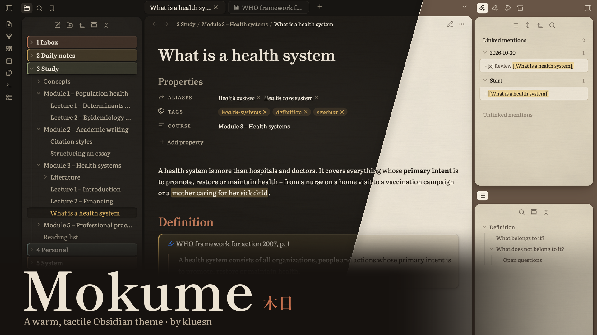
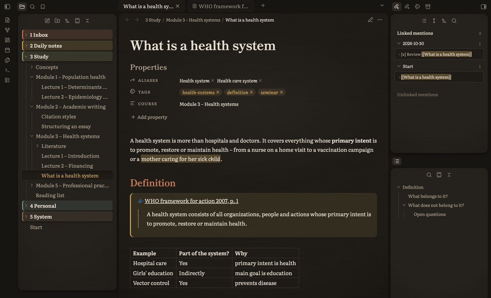
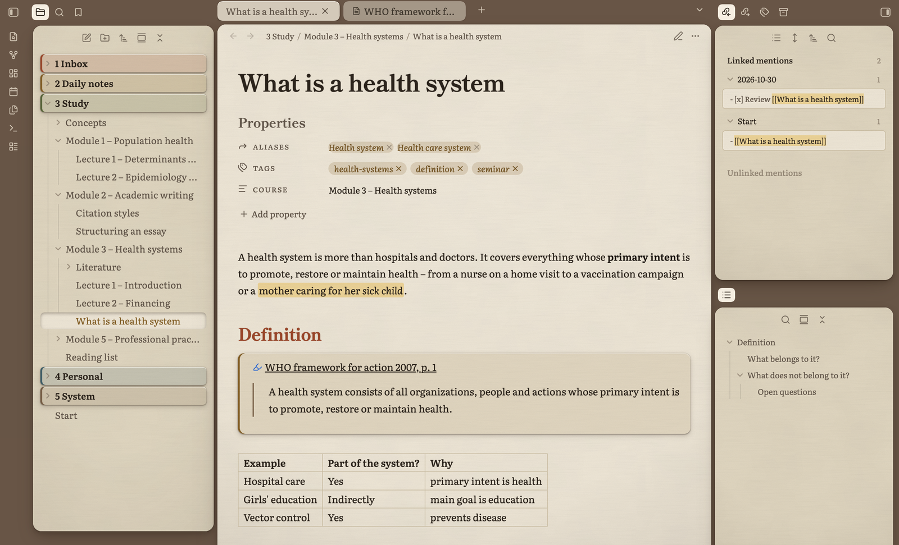

# Mokume

*木目 – Japanese for “wood grain”*

A warm, tactile theme for Obsidian, made for the long hours you spend in your notes. Instead of sterile white and cold greys, Mokume uses warm, earthy tones, soft shadows and paper with a fine, tactile grain. No harsh contrast and no hard divider lines: sidebar, editor and tabs rest like cards on a quiet desk, so the screen feels calm and easy on the eyes.

| Dark mode | Light mode |
| --- | --- |
|  |  |

## Features

- **Dark and light mode** – a cosy, espresso-toned dark mode and a soft, warm light mode
- **Classic serif typography** – Fraunces for headings and Source Serif 4 for body text and the interface, both embedded, nothing to install
- **Tactile, calm surfaces** – fine paper grain and fibres, subtle mottling, soft lamp light, no harsh white
- **Floating cards** – sidebar, editor and tabs sit on the desk with consistent gaps and soft shadows, no hard divider lines
- **Folder chips** – top-level folders as coloured index cards
- **Drop cap** – every note opens with a gentle initial
- **PDF++ support** – quote callouts and highlights styled to match, toolbar without divider line
- **Adjustable** with the [Style Settings](https://github.com/mgmeyers/obsidian-style-settings) plugin

## Style Settings

With Style Settings installed you can adjust:

| Area | Options |
| --- | --- |
| Surface | gap between cards, shadow strength, paper grain, paper fibres, darker page edges, lamp light, paper mottling on/off |
| Colours | desk, page, sidebar and three accent colours, separately for light and dark mode |
| Typography | line height, sans-serif interface, drop cap on/off |
| Elements | plain top-level folders, PDF++ quotes in their own highlight colour, background tabs without card |

## Recommended settings

- Settings → Appearance → **Window frame style: Obsidian frame** gives the cleanest window corners on macOS.
- Leave the font fields under Settings → Appearance → Font empty, otherwise they override the theme's fonts.

## Credits

- Fraunces by Undercase Type (Phaedra Charles, Flavia Zimbardi), SIL Open Font License 1.1
- Source Serif 4 by Frank Grießhammer / Adobe, SIL Open Font License 1.1 – embedded as a subset under the name “Mokume Serif Text”, since “Source” is a Reserved Font Name
- Colour names inspired by traditional Japanese colours

## License

Theme code: MIT, see [LICENSE](LICENSE). Embedded fonts: SIL Open Font License 1.1, see [OFL.txt](OFL.txt).

---

## Deutsch

Mokume (木目) ist japanisch für „Holzmaserung“. Ein warmes, haptisches Theme für Obsidian, gemacht für lange Stunden am Bildschirm: erdige Farben statt sterilem Weiß, weiche Schatten, Papier mit feiner Struktur und Karten, die ruhig auf der Arbeitsfläche liegen. Dunkel- und Hellmodus, Schriften eingebettet, viele Details über das Plugin Style Settings einstellbar.
